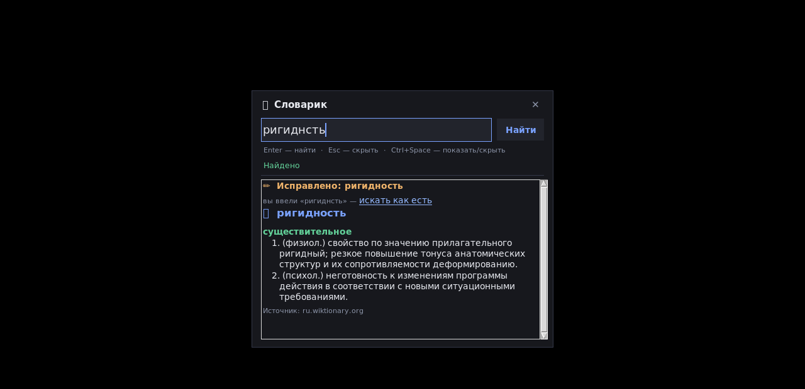

# 📖 Словарик

Всплывающее окошко-словарь поверх всех окон: по горячей клавише вызывается в любом
приложении, слово ищется по `Enter`, опечатки исправляются автоматически.

> Русский текст → **русский Викисловарь** (`ru.wiktionary.org`).
> Английский текст → **dictionaryapi.dev** (запасной источник — английский Wiktionary).
> Опечатки → **Яндекс.Спеллер**, причём и для русского, и для английского.

Помимо обычных слов, разбираются и **формы слов**: «идёт», «думает», «стола»
показываются с описанием времени, лица, рода, числа, падежа и значения формы.


---

## 🚀 Быстрый старт (Windows)

1. **Скачайте проект** — на странице этого репозитория нажмите зелёную кнопку
   **«Code» → «Download ZIP»** и распакуйте архив в удобное место.
2. **Установите Python** (если ещё нет): https://www.python.org/downloads/
   При установке обязательно отметьте галочку **«Add python.exe to PATH»**.
3. **Запустите** файл **`Запуск.bat`** (двойной щелчок).
   Он сам поставит нужный пакет `keyboard`, если его нет, и запустит приложение
   без чёрного окна консоли.
4. Внизу справа у часов появится приложение. Нажмите **`Ctrl+Space`** — откроется
   окошко «Словарик».

Ручной запуск (то же самое):

```bat
pip install keyboard
pythonw slovarik.py
```

`pythonw` запускает без окна консоли, `python` — с консолью (удобно, чтобы видеть
ошибки при первом запуске).

---

## ⌨️ Как пользоваться

| Действие | Клавиши / действие |
|---|---|
| Показать / скрыть окошко | **`Ctrl+Space`** (работает из любого приложения) |
| Найти слово | наберите и нажмите **`Enter`** |
| Скрыть окошко | **`Esc`** или **`✕`** |
| Выйти из приложения | **`Ctrl+Q`** или правый щелчок → «Выход» |
| Выделить всё в поле ввода | `Ctrl+A` |
| Скопировать результат | правый щелчок → «Копировать результат» |
| Перейти к подсказке | щёлкните по синему слову в результате |
| Перетащить окошко | потянуть за заголовок «Словарик» |

Если слово написано с опечаткой — приложение сначала покажет строку
«✏️ Исправлено: …», а рядом ссылку «искать как есть», чтобы посмотреть, что
найдётся по исходному написанию.



---

## ⚙️ Настройки — файл `slovarik.json`

Файл появляется рядом с программой при первом запуске. Откройте его блокнотом,
поменяйте значения и перезапустите приложение.

```json
{
  "hotkey": "ctrl+space",     // горячая клавиша: "ctrl+alt+s", "alt+space", "ctrl+shift+f1" и т.п.
  "suppress_hotkey": false,   // true — «съедать» нажатие, чтобы оно не попадало в приложение под окном
  "opacity": 0.98,            // прозрачность окна: 0.3 … 1.0
  "width": 480,               // ширина окна
  "height": 410,              // высота окна
  "top_ratio": 0.16,          // отступ окна от верха экрана (доля высоты экрана)
  "timeout": 10,              // таймаут запросов к API, секунды
  "max_defs": 5               // сколько значений показывать на одну часть речи
}
```

## 📚 Источники данных

| Что | Откуда | Примечание |
|---|---|---|
| Русские слова | [ru.wiktionary.org](https://ru.wiktionary.org) | разбирается вики-разметка: часть речи, значения, пометы `(зоол.)`, `(перен.)`, формы слов |
| Английские слова | [dictionaryapi.dev](https://dictionaryapi.dev) | транскрипция, часть речи, значения и примеры |
| Русские слова, которых нет в ru.Wiktionary | английский Wiktionary (раздел *Russian*) | толкование будет на английском — это редкий запасной вариант |
| Исправление опечаток | Яндекс.Спеллер (открытый API) | работает офлайн-независимо, отдельным запросом |

Приложение **само определяет язык**: есть кириллица → русский источник, иначе английский.
Выбор языка вручную не нужен.

Результаты **кэшируются** в `slovarik_cache.json` — повторные слова ищутся мгновенно
и не дёргают чужие серверы. Ещё это защищает от ограничения частоты запросов:
Викисловарь иногда отвечает `429 Too Many Requests` — в этом случае приложение
покажет понятное сообщение «повторите через ~N сек.».

---

## 📦 Сборка в один `.exe` (необязательно)

Чтобы не зависеть от установленного Python, можно собрать один исполняемый файл.
Запустите **`Собрать EXE.bat`** — он установит PyInstaller и соберёт `dist\Slovarik.exe`.

```bat
python -m pip install pyinstaller
python -m PyInstaller --noconfirm --clean --onefile --noconsole --name Slovarik slovarik.py
```

Готовый `Slovarik.exe` можно переименовать в `Словарик.exe`, скопировать в удобное
место (например, `C:\Tools\Словарик\`) и запускать двойным щелчком. Файлы
`slovarik.json` и `slovarik_cache.json` при этом создаются рядом с `.exe`.

> Antivirus может «поругаться» на свежесобранный exe (типичная реакция на PyInstaller) —
> добавьте его в исключения.

---

## 🛠️ Частые вопросы

**Хоткей `Ctrl+Space` не работает или мешает другому приложению.**
Смените его в `slovarik.json`, например: `"hotkey": "ctrl+alt+s"`, `"hotkey": "alt+space"`,
`"hotkey": "ctrl+shift+d"`. После изменения перезапустите приложение.

**Горячая клавиша не срабатывает, когда активно другое приложение.**
Пакет `keyboard` под Windows ставит низкоуровневый «хук» клавиатуры. В 64-битной Windows
он может не видеть нажатия в приложениях, запущенных **от имени администратора**, пока
сам «Словарик» работает без этих прав. Решение: запускать «Словарик» тоже от
администратора либо не запускать целевые приложения с повышением прав.

**«Нет соединения с интернетом» или «ограничил частоту запросов».**
Проверьте сеть и попробуйте ещё раз через 15–30 секунд. Ограничение частоты
приходит от Викисловаря, если много запросов подряд с одного IP.

**Приложение запустилось, но окошка не видно.**
Оно могло открыться за другим окном (окно без рамки, поверх всех — помогает
`Ctrl+Space`). Если что-то совсем не работает, посмотрите `slovarik.log` рядом
с программой и запустите в консоли, чтобы увидеть ошибки:

```bat
python slovarik.py
```

**Проверить поиск без графического окна:**

```bat
python slovarik.py --cli ригидность     :: обычный поиск
python slovarik.py --cli helo --no-fix  :: без исправления опечаток
python slovarik.py --cli world --json   :: результат в виде JSON
```

---

## 🗂️ Состав файлов

| Файл | Назначение |
|---|---|
| `slovarik.py` | само приложение (только стандартная библиотека + `keyboard`) |
| `Запуск.bat` | запуск в один щелчок (сам проверит Python и пакет `keyboard`) |
| `Собрать EXE.bat` | сборка автономного `Slovarik.exe` |
| `requirements.txt` | список зависимостей (`keyboard`) |
| `LICENSE` | лицензия MIT — можно свободно использовать и изменять |
| `slovarik.json` | настройки (создаётся при первом запуске) |
| `slovarik_cache.json` | кэш найденных слов (создаётся автоматически) |
| `slovarik.log` | журнал ошибок (появляется, только если что-то пошло не так) |
| `screenshots/` | скриншоты работы приложения |
| `tests/test_slovarik.py` | автотесты разбора вики-разметки (интернет не нужен) |
| `CHANGELOG.md` | история изменений по версиям |

## ✅ Что проверено

Логика и интерфейс протестированы автоматически (**39 проверок**): запуск и показ
по хоткею, фокус в поле ввода, поиск русских и английских слов, исправление
опечаток, кликабельные ссылки, экран «ничего не нашлось», копирование результата,
выделение `Ctrl+A`, закрытие по `Esc`.

Разбор русского Викисловаря проверен на 18 словах — «ригидность», «кошка», «бежать»,
«молоко», «красивый», «дрочила», «идёт», «стола», «лучше», «пальто», «сосулька»
и других: толкования, пометы и грамматические формы разбираются без пустых
и обрезанных значений. Автотесты можно запустить самому (интернет не нужен):

```bat
python -m unittest discover -s tests
```

> Оболочка приложения протестирована автоматическими проверками на виртуальном
> дисплее: показ и скрытие окна, фокус в поле ввода, поиск русских и английских слов,
> исправление опечаток, ссылки, экран «ничего не нашлось», копирование результата.
> Глобальная горячая клавиша работает через низкоуровневый «хук» клавиатуры Windows
> и включается при первом же запуске; если её перехватит другая программа, «Словарик»
> покажет предупреждение прямо в окне и подскажет, что делать. Linux и macOS тоже
> поддерживаются, но основная платформа — Windows.

## 📄 Лицензия

Проект распространяется по лицензии [MIT](LICENSE): код можно свободно использовать,
изменять и распространять — достаточно сохранить упоминание об авторе.
